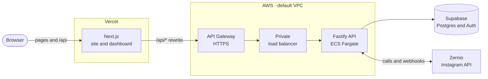
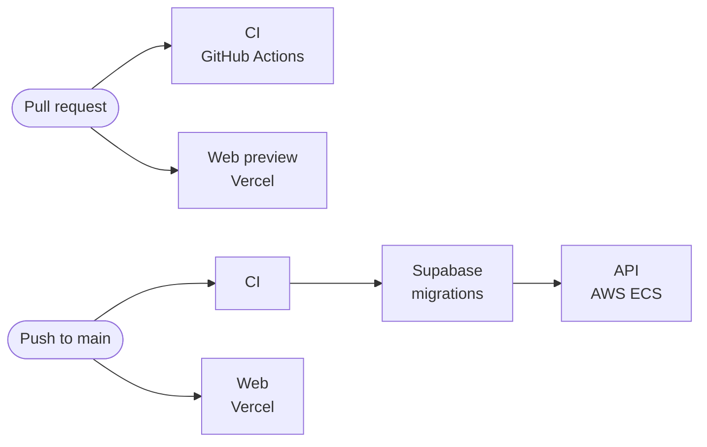

<div align="center">

# aghost

**Reply to Instagram comments with automatic DMs.**

Comment-to-DM automation built with Next.js, Fastify, Supabase, and Zernio.

[](https://github.com/Thinking-Sound-Lab/aghost/actions/workflows/deploy.yml)

[Stack](#stack) · [Architecture](#architecture) · [Run locally](#run-locally) · [Configuration](#configuration) · [Testing](#testing) · [Deployment](#deployment)

</div>

---

## Stack

| Layer              | Built with                                                            |
| ------------------ | --------------------------------------------------------------------- |
| **Web**            | Next.js marketing site and dashboard, Zustand, shadcn/ui · on Vercel  |
| **API**            | Fastify on Node.js 22, domain services in `packages/api` · on AWS ECS |
| **Data and auth**  | Supabase Postgres with row-level security, Supabase Auth              |
| **Instagram**      | Zernio for account connections, automations, inbox, and contacts      |
| **Infrastructure** | AWS CDK in TypeScript, GitHub Actions, Turborepo, pnpm                |

## Architecture



- **One origin for the browser.** Pages and `/api` share the web app's origin; Next.js rewrites `/api/*` to the API. Locally, the same proxy points at the API in Docker.
- **UI in the app, rules in the package.** Business rules and provider calls live in `packages/api`. The web app renders UI and calls the API through its typed client.
- **Tenant isolation.** Supabase row-level security scopes reads to a workspace, and the API verifies the user before privileged writes. Account webhook updates and their deduplication ledger entry commit in one transaction.
- **No credentials in the browser.** Provider keys stay in the API. Session cookies are HttpOnly and use Secure on HTTPS origins.

## Run locally

You need Node.js 22 or newer, pnpm, and Docker with Docker Compose.

```sh
pnpm install
pnpm dev
```

`pnpm dev` prepares the root `.env`, starts Supabase in Docker and applies pending migrations, starts the API in Docker, and then starts Next.js on the host. API changes reload inside the container; web changes use hot reload.

| Service         | Address                                   |
| --------------- | ----------------------------------------- |
| Web app         | [localhost:3000](http://localhost:3000)   |
| API             | `127.0.0.1:4000`                          |
| Supabase Studio | [localhost:54323](http://localhost:54323) |
| Email previews  | [localhost:54324](http://localhost:54324) |

Closing the web process leaves the Docker services running; `pnpm local:stop` stops them and keeps the database.

> [!NOTE]
> The stack uses fixed local ports, so run it in one workspace at a time. The Supabase CLI manages its containers from `supabase/config.toml`, and `compose.yaml` runs the API on Supabase's Docker network.

### Commands

| Command             | What it does                                                                          |
| ------------------- | ------------------------------------------------------------------------------------- |
| `pnpm dev`          | Starts the Docker backend, then the web app                                           |
| `pnpm local:start`  | Starts or rebuilds the Docker backend only. Run it after changing env or dependencies |
| `pnpm local:stop`   | Stops the API, webhook tunnel, and Supabase. Database data is kept                    |
| `pnpm local:logs`   | Follows the API's logs                                                                |
| `pnpm local:status` | Shows the API container                                                               |
| `pnpm local:tunnel` | Receives Zernio webhooks on your machine ([below](#zernio-webhooks-locally))          |
| `pnpm db:status`    | Shows the local Supabase services                                                     |
| `pnpm db:types`     | Regenerates `packages/supabase/src/database.types.ts`                                 |
| `pnpm db:reset`     | Resets the local database. **Destructive**: only for disposable data                  |

### Zernio webhooks locally

Zernio notifies the API when an Instagram account connects or disconnects. To receive those events on your machine, run:

```sh
pnpm local:tunnel
```

This starts a [Cloudflare quick tunnel](https://developers.cloudflare.com/tunnel/get-started/quick-tunnels/) in Docker, which needs no Cloudflare account. Only `/api/webhooks/zernio` is public; Cloudflare answers 404 for every other path. The command then:

1. Generates `ZERNIO_WEBHOOK_SECRET` in the root `.env` if it is empty.
2. Creates or updates a Zernio webhook named `aghost local tunnel` that points to the tunnel and subscribes to `account.connected` and `account.disconnected`.
3. Asks Zernio to send a test event through the tunnel, and fails if it is not delivered.

`ZERNIO_API_KEY` is required. Deliveries and their status codes appear in `pnpm local:logs`; a 401 means the signature did not match the secret.

The trycloudflare.com address changes each time the tunnel starts, so run `pnpm local:tunnel` again after `pnpm local:stop` or a Docker restart. While the tunnel is stopped, deliveries to the old address fail; you can resend them from Zernio's webhook logs. Connecting an account does not depend on the tunnel: after authorization, `/accounts/callback` reads the account list from Zernio directly.

## Configuration

**`.env` at the repository root is the only local configuration file.** Its template is [.env.example](.env.example). `pnpm dev` and `pnpm setup:local` create it, fill in the local Supabase keys, and never overwrite values you set. Do not add env files under `apps/server` or `apps/web`.

| Variable                   | Read by | Purpose                                                        |
| -------------------------- | ------- | -------------------------------------------------------------- |
| `APP_URL`                  | API     | The browser-facing origin, for origin checks and redirects     |
| `API_URL`                  | Web     | Where Next.js forwards `/api` requests                         |
| `API_PORT`                 | API     | The port the API listens on                                    |
| `API_HOST`                 | API     | The interface the API listens on                               |
| `SUPABASE_URL`             | API     | Supabase's address from the host, also used by tests           |
| `SUPABASE_PUBLISHABLE_KEY` | API     | Filled in by setup                                             |
| `SUPABASE_SECRET_KEY`      | API     | Filled in by setup                                             |
| `ZERNIO_API_URL`           | API     | The Zernio API                                                 |
| `ZERNIO_API_KEY`           | API     | Enables Instagram features; empty leaves them unavailable      |
| `ZERNIO_WEBHOOK_SECRET`    | API     | Verifies webhook signatures; `pnpm local:tunnel` generates one |

To connect Instagram, set `ZERNIO_API_KEY` and run `pnpm local:start`. Without it, sign-in and workspaces work and Instagram connections are explicitly unavailable; the app never substitutes sample accounts or analytics.

- Only `API_URL` reaches Next.js. Supabase and Zernio credentials go to the API container only. Env files are ignored by Git and excluded from Docker images.
- Compose gives the API container `http://supabase_kong_aghost:8000` as `SUPABASE_URL`, so it talks to Supabase over the Docker network.
- For a public or tunneled setup, update `APP_URL` and allow `/api/auth/callback` in Supabase's redirect URLs. Zernio redirects authorized Instagram connections to `/accounts/callback`.
- Deployed environments inject these variables directly; no env file is needed.

## Project structure

```text
.
├── apps
│   ├── web/             Next.js pages, UI features, and Zustand stores
│   └── server/          Fastify entry point and Dockerfiles
├── packages
│   ├── api/             Contracts, client, services, routes, Supabase and Zernio adapters
│   ├── env/             Validation of environment variables
│   ├── supabase/        Database clients and generated types
│   └── ui/              Shared shadcn components
├── infra/               AWS CDK app for the API
├── supabase/            CLI config and forward-only migrations
├── scripts/             Local setup, env, and verification helpers
├── .github/             CI and deployment workflows
├── compose.yaml         Local API container, webhook tunnel, and Supabase network
└── .env.example         The configuration template
```

## Testing

```sh
pnpm verify        # types, lint, tests, and production builds
pnpm verify:local  # end-to-end checks against the running app
```

`pnpm verify` runs the integration tests against the local Supabase stack, so start it first with `pnpm setup:local` or `pnpm dev`. CI uses `pnpm setup:test` instead, which starts only what the tests need. Provider adapter tests use a local HTTP fixture and never send real Instagram messages. The infrastructure tests synthesize both CDK stacks offline.

With the app running, `pnpm verify:local` checks pages, HttpOnly authentication through the Next.js proxy, workspace persistence, sign-out, and password-recovery emails and PKCE callbacks. It removes its disposable user and emails afterwards. Browser interaction and visual review are separate checks.

Live OAuth and comment-to-DM delivery need Zernio credentials and an authorized professional Instagram account.

## Deployment



| Workflow        | Runs on                    | Steps                                  |
| --------------- | -------------------------- | -------------------------------------- |
| `ci.yml`        | Pull requests, releases    | Format, lint, types, tests, builds     |
| `deploy.yml`    | Push to `main`, manual run | CI → one Release job: migrations → API |
| `actions/setup` | Every job                  | pnpm, Node.js 22, and dependencies     |

A push to `main` releases the backend in one job, so a release needs one approval and its steps run in order: the schema, then the API that uses it. Only `main` can release; other branches are refused by the workflow and by the `prod` environment. An unchanged API deploys as a no-op: its image is built from the server's packages only, so the CDK finds it already in ECR and CloudFormation finds no changes.

### Web on Vercel

The marketing site and dashboard are one Next.js app. Vercel's Git integration builds it: a preview for every pull request, and production on every push to `main`. No Vercel credentials are stored in GitHub.

> [!NOTE]
> Vercel and the Release job start from the same push and finish independently, usually Vercel first. Keep an API change compatible with the web app that is already live, or merge the API change first.

The Vercel CLI does not read `.gitignore`, so [`.vercelignore`](.vercelignore) keeps local env files out of a deploy made by hand from a developer's machine.

### API on AWS

[`infra/`](infra/) defines the API with the AWS CDK:

- **Compute.** x86_64 Fargate tasks, from two to four as CPU demands. Autoscaling owns the task count, so a deployment never resets it.
- **Address.** An API Gateway HTTPS endpoint, which needs no domain, DNS record, or certificate. It reaches a private load balancer through a VPC link.
- **Network.** The account's default VPC. Tasks get public addresses for their outbound calls to Supabase, Zernio, and ECR; their security group admits traffic only from the load balancer, and the load balancer only from API Gateway.
- **Image.** Built from `turbo prune server --docker` output: the server's workspace packages and their dependencies, nothing else.
- **Secrets.** Supabase and Zernio credentials come from Secrets Manager at task start.
- **Releases.** New tasks must pass `/api/health` before old ones stop, and the circuit breaker rolls back a release that never becomes healthy. Logs are kept for 30 days.
- **Access.** GitHub Actions signs in through OIDC, without stored AWS keys. Its role can only use the roles that `cdk bootstrap` created.

```text
infra
├── bin/app.ts                         Reads the stage's settings and creates the stacks
├── lib/config.ts                      Validates the settings and names any missing variable
├── lib/build-context.ts               Prunes the repository to the server for the image
├── lib/stacks/api-stack.ts            Default VPC, image, DNS zone, and credentials of a stage
├── lib/constructs/api-service.ts      Fargate service, load balancer, health checks, scaling
├── lib/stacks/github-deploy-stack.ts  The role GitHub Actions deploys with
└── test/                              Assertions on the synthesized templates
```

### One-time setup

**1. AWS.** From the repository root and with administrator credentials, run:

```sh
export STAGE=prod AWS_ACCOUNT_ID=123456789012 AWS_REGION=ap-south-1 \
  APP_URL=https://aghost.vercel.app SUPABASE_URL=https://your-project.supabase.co

pnpm --filter infra exec cdk bootstrap "aws://$AWS_ACCOUNT_ID/$AWS_REGION"

aws iam create-open-id-connect-provider \
  --url https://token.actions.githubusercontent.com --client-id-list sts.amazonaws.com

aws secretsmanager create-secret --name aghost/prod/api --secret-string '{
  "SUPABASE_PUBLISHABLE_KEY": "…",
  "SUPABASE_SECRET_KEY": "…",
  "ZERNIO_API_KEY": "…",
  "ZERNIO_WEBHOOK_SECRET": "…"
}'

pnpm --filter infra exec cdk deploy --all
```

The deployment prints `DeployRoleArn` for step 3 and `ApiUrl`, the API's address, for step 2.

> [!NOTE]
> Skip `cdk bootstrap` and `create-open-id-connect-provider` if the account already has them; the stacks use what exists. If the region's default VPC was deleted, recreate it with `aws ec2 create-default-vpc`. `supabase projects api-keys --reveal` prints the Supabase keys; without `--reveal`, the secret key is masked and will not work.

**2. Vercel.** Create a project with the root directory `apps/web`, connect it to the GitHub repository, and add `API_URL=<ApiUrl>` to its Production and Preview environments. `APP_URL` is the address Vercel serves the project at.

**3. GitHub.** Under **Settings → Environments**, create `prod`, limit its deployment branches to `main`, and add:

| Name                    | Type     | Value                                            |
| ----------------------- | -------- | ------------------------------------------------ |
| `AWS_ACCOUNT_ID`        | Variable | The 12-digit account ID                          |
| `AWS_REGION`            | Variable | For example `ap-south-1`                         |
| `AWS_DEPLOY_ROLE_ARN`   | Variable | `DeployRoleArn` from step 1                      |
| `APP_URL`               | Variable | The web origin, for example `https://aghost.com` |
| `SUPABASE_URL`          | Variable | `https://<project>.supabase.co`                  |
| `SUPABASE_PROJECT_ID`   | Variable | The Supabase project's reference ID              |
| `SUPABASE_POOLER_URL`   | Variable | The project's session pooler address             |
| `SUPABASE_ACCESS_TOKEN` | Secret   | A scoped Supabase access token                   |

Create the token in the Supabase dashboard under **Account → Access Tokens**. Scope it to this project only, with **Database: Read-write**. The Release job uses it to create a short-lived database role for the migrations, so no database password is stored.

GitHub's runners have no IPv6, and the database's direct address is IPv6-only, so migrations connect through the IPv4 session pooler. Its address has no password: `postgresql://postgres.<project>@<pooler-host>:5432/postgres`, shown in the dashboard under **Connect → Session pooler**, or saved to `supabase/.temp/pooler-url` by `supabase link`.

> [!TIP]
> Add required reviewers to the `prod` environment to approve each release before it starts.

**4. Supabase and Zernio.** Allow `<APP_URL>/api/auth/callback` in Supabase's redirect URLs. Point the Zernio webhook to `<ApiUrl>/api/webhooks/zernio` with the same secret, subscribed to `account.connected` and `account.disconnected`.

> [!NOTE]
> The API accepts writes only from `APP_URL`'s origin. Previews show the site and dashboard, but signing in from a preview is refused.

### Reviewing infrastructure changes

With AWS credentials and the variables from step 1, compare a change with what is deployed:

```sh
pnpm --filter infra exec cdk diff Aghost-prod-Api
```

Synthesis looks up the default VPC in the account, so it needs credentials; the tests use a recorded copy and run offline.
