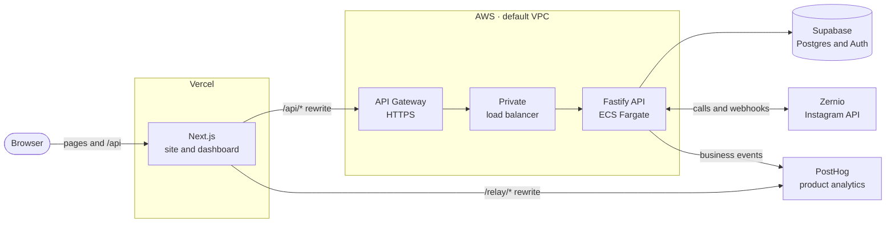

<div align="center">


# aghost

**Agentic DM automation for Instagram.**

Create, manage and monitor comment-to-DM automations, and schedule the Instagram posts they answer, through MCP, the REST API, or the dashboard. The dashboard also cross-posts to Facebook, LinkedIn, X, Threads and YouTube, with analytics for each channel. MCP and API access are included on every plan.

[](https://github.com/Thinking-Sound-Lab/aghost/actions/workflows/deploy.yml)

[Stack](#stack) · [Architecture](#architecture) · [Run locally](#run-locally) · [Configuration](#configuration) · [API](#api) · [MCP](#mcp) · [Analytics](#analytics) · [Brand](#brand) · [Search and AI assistants](#search-and-ai-assistants) · [Testing](#testing) · [Deployment](#deployment)

</div>

---

## Stack

| Layer              | Built with                                                                                                |
| ------------------ | --------------------------------------------------------------------------------------------------------- |
| **Web**            | Next.js marketing site and dashboard, Zustand, shadcn/ui · on Vercel                                      |
| **API**            | Fastify on Node.js 22, domain services in `packages/api` · on AWS ECS                                     |
| **Data and auth**  | Supabase Postgres with row-level security, Supabase Auth                                                  |
| **Channels**       | Zernio for six platforms' accounts, publishing, and analytics; Instagram automations, inbox, and contacts |
| **Analytics**      | PostHog for product events, web analytics, and session replay                                             |
| **Infrastructure** | AWS CDK in TypeScript, GitHub Actions, Turborepo, pnpm                                                    |

## Architecture



- **One origin for the browser.** Pages and `/api` share the web app's origin; Next.js rewrites `/api/*` to the API. Locally, the same proxy points at the API in Docker.
- **UI in the app, rules in the package.** Business rules and provider calls live in `packages/api`. The web app renders UI and calls the API through its typed client.
- **Tenant isolation.** Supabase row-level security scopes reads to a workspace, and the API verifies the user before privileged writes. Account webhook updates and their deduplication ledger entry commit in one transaction.
- **No credentials in the browser.** Provider keys stay in the API. Session cookies are HttpOnly and use Secure on HTTPS origins.
- **Agent access.** REST and MCP have separate route modules and Settings tabs. Workspace API keys authenticate both interfaces, which share business operations, validation, and permissions. Key hashes are backend-only; full tokens are shown once.

## Run locally

You need Node.js 22 or newer, pnpm, and Docker with Docker Compose.

```sh
pnpm install
pnpm dev
```

The first run stops and asks for a Google OAuth client: see [Google sign-in](#google-sign-in).

`pnpm dev` prepares the root `.env`, starts Supabase in Docker and applies pending migrations, starts the API in Docker, and then starts Next.js on the host. API changes reload inside the container; web changes use hot reload.

| Service         | Address                                   |
| --------------- | ----------------------------------------- |
| Web app         | [localhost:3000](http://localhost:3000)   |
| API             | `127.0.0.1:4000`                          |
| Supabase Studio | [localhost:54323](http://localhost:54323) |

Closing the web process leaves the Docker services running; `pnpm local:stop` stops them and keeps the database.

> [!NOTE]
> The stack uses fixed local ports, so run it in one workspace at a time. The Supabase CLI manages its containers from `supabase/config.toml`, and `compose.yaml` runs the API on Supabase's Docker network.

### Commands

| Command             | What it does                                                                          |
| ------------------- | ------------------------------------------------------------------------------------- |
| `pnpm dev`          | Starts the Docker backend, then the web app                                           |
| `pnpm local:start`  | Starts or rebuilds the Docker backend only. Run it after changing env or dependencies |
| `pnpm local:stop`   | Stops the API, webhook tunnel, and Supabase. Database data is kept                    |
| `pnpm local:logs`   | Follows the API's logs                                                                |
| `pnpm local:status` | Shows the API container                                                               |
| `pnpm local:tunnel` | Receives Zernio webhooks on your machine ([below](#zernio-webhooks-locally))          |
| `pnpm db:status`    | Shows the local Supabase services                                                     |
| `pnpm db:types`     | Regenerates `packages/supabase/src/database.types.ts`                                 |
| `pnpm db:reset`     | Resets the local database. **Destructive**: only for disposable data                  |

### Google sign-in

Google is the only way to sign in, and a first sign-in creates the account. Supabase does the exchange with Google, so it holds the OAuth client:

1. In the [Google Cloud console](https://console.cloud.google.com/apis/credentials), create an OAuth client ID of type **Web application**.
2. Add `http://127.0.0.1:54321/auth/v1/callback` to its authorized redirect URIs.
3. Set `SUPABASE_AUTH_EXTERNAL_GOOGLE_CLIENT_ID` and `SUPABASE_AUTH_EXTERNAL_GOOGLE_SECRET` in the root `.env`.

Supabase reads both values when it starts. After changing them, or after switching from a branch with different sign-in settings, run `pnpm local:stop` and then `pnpm dev`.

### Provider webhooks locally

Zernio notifies the API when an Instagram account connects or disconnects, and when messages are sent or received. Message events schedule and cancel follow-up nudges. To receive those events on your machine, run:

```sh
pnpm local:tunnel
```

This starts a [Cloudflare quick tunnel](https://developers.cloudflare.com/tunnel/get-started/quick-tunnels/) in Docker, which needs no Cloudflare account. Only `/api/webhooks/zernio` and `/api/webhooks/dodo` are public; Cloudflare answers 404 for every other path. With Zernio configured, the command:

1. Generates `ZERNIO_WEBHOOK_SECRET` in the root `.env` if it is empty.
2. Creates or updates a Zernio webhook named `aghost local tunnel` that points to the tunnel and subscribes to `account.connected`, `account.disconnected`, `message.sent`, and `message.received`.
3. Asks Zernio to send a test event through the tunnel, and fails if it is not delivered.

Set `ZERNIO_API_KEY` or a Dodo test-mode API key. With Dodo configured, the command also registers its local subscription/payment webhook, stores the signing secret in the root `.env`, and recreates the API container. Deliveries and their status codes appear in `pnpm local:logs`; a 401 means the signature did not match the secret.

The trycloudflare.com address changes each time the tunnel starts, so run `pnpm local:tunnel` again after `pnpm local:stop` or a Docker restart. While the tunnel is stopped, deliveries to the old address fail; you can resend them from Zernio's webhook logs. Connecting an account does not depend on the tunnel: after authorization, `/accounts/callback` reads the account list from Zernio directly.

## Configuration

**`.env` at the repository root is the only local configuration file.** Its template is [.env.example](.env.example). `pnpm dev` and `pnpm setup:local` create it, fill in the local Supabase keys, and never overwrite values you set. Do not add env files under `apps/server` or `apps/web`.

| Variable                                  | Read by  | Purpose                                                          |
| ----------------------------------------- | -------- | ---------------------------------------------------------------- |
| `APP_URL`                                 | API, Web | The browser-facing origin, for origin checks and canonical links |
| `API_URL`                                 | Web      | Where Next.js forwards `/api` requests                           |
| `API_PORT`                                | API      | The port the API listens on                                      |
| `API_HOST`                                | API      | The interface the API listens on                                 |
| `SUPABASE_URL`                            | API      | Supabase's address from the host, also used by tests             |
| `SUPABASE_PUBLISHABLE_KEY`                | API      | Filled in by setup                                               |
| `SUPABASE_SECRET_KEY`                     | API      | Filled in by setup                                               |
| `SUPABASE_AUTH_EXTERNAL_GOOGLE_CLIENT_ID` | Supabase | The Google OAuth client for [sign-in](#google-sign-in)           |
| `SUPABASE_AUTH_EXTERNAL_GOOGLE_SECRET`    | Supabase | That client's secret                                             |
| `ZERNIO_API_URL`                          | API      | The Zernio API                                                   |
| `ZERNIO_API_KEY`                          | API      | Enables Instagram features; empty leaves them unavailable        |
| `ZERNIO_WEBHOOK_SECRET`                   | API      | Verifies webhook signatures; `pnpm local:tunnel` generates one   |
| `DODO_PAYMENTS_ENVIRONMENT`               | API      | `test_mode` locally; `live_mode` for production billing          |
| `DODO_PAYMENTS_API_KEY`                   | API      | Enables checkout, plan changes, and the billing portal           |
| `DODO_PAYMENTS_WEBHOOK_KEY`               | API      | Verifies Dodo subscription and payment webhook signatures        |
| `POSTHOG_KEY`                             | API, Web | PostHog project key; empty leaves [analytics](#analytics) off    |
| `POSTHOG_HOST`                            | API, Web | PostHog's address for the project's region                       |

The dashboard, REST API and MCP need a plan: after sign-in the app shows only the paywall until the workspace subscribes, so configure Dodo to use it locally. To connect channels, also set `ZERNIO_API_KEY`. Pro, Growth and Business cost $29 / $39 / $49 per month for 1 / 2 / 10 social sets, each one account on every platform, billed in US dollars in every country with taxes included. Yearly billing is about 20% less, paid upfront. See [pricing and billing setup](docs/billing.md) and [channels](docs/channels.md). Without Dodo credentials, sign-in works and nobody can subscribe. Without Zernio credentials, Instagram features are unavailable; the app never substitutes sample accounts or analytics.

- Only `APP_URL`, `API_URL` and the PostHog key and host reach Next.js; the PostHog key is public by design. Supabase, Zernio and Dodo credentials go to the API container only, and the Google client to Supabase only. Env files are ignored by Git and excluded from Docker images.
- Compose gives the API container `http://supabase_kong_aghost:8000` as `SUPABASE_URL`, so it talks to Supabase over the Docker network.
- For a public or tunneled setup, update `APP_URL` and allow `/api/auth/callback` in Supabase's redirect URLs. Zernio redirects authorized Instagram connections to `/accounts/callback`.
- Deployed environments inject these variables directly; no env file is needed.

## API

Open **Settings → API**, click **+ API key**, and name your workspace key in the dialog. After creation, copy and save the key before closing the dialog; the full key will not be shown again. Agents can create, edit, pause, activate, and delete automations; schedule, edit, and cancel Instagram posts with their automations; inspect statistics and delivery activity; read accounts, posts, contacts, and inbox conversations; and send inbox messages.

Call `<APP_URL>/api/v1` with `Authorization: Bearer <key>`. New keys have full agent access and no expiry; revoke them in Settings to stop access. `GET /api/v1/openapi.json` provides the REST API contract. See the [REST API guide](docs/api.md) for requests and deployment requirements.

## MCP

Open **Settings → MCP** for your endpoint and client configuration. **Copy skill** gives Claude Code, Codex, Cursor, or another agent instructions to configure the connection. Use `<APP_URL>/api/mcp` with an HTTP MCP client and a key created in the API tab. New keys can use every Aghost agent tool. Apps that sign in to MCP servers, such as Claude's custom connectors, need only the URL: the owner approves the app in aghost, and it receives its own key.

MCP has its own backend route module on the same server as the API. See the [MCP guide](docs/mcp.md) for client setup, available tools, and examples.

## Analytics

PostHog records the product end to end. The browser records page views, clicks, web vitals, errors and session replays through a same-origin `/relay`. The API records what happened, whether in the dashboard, through an agent over REST or MCP, or by webhook: sign-ups, checkouts, subscription changes and revenue, account connections, automations, and every agent tool call. Browser and API events share the signed-in user's id and are grouped by workspace. Instagram users' messages and contacts stay out of replays.

Set `POSTHOG_KEY` and `POSTHOG_HOST` to turn it on. See [the analytics guide](docs/analytics.md) for production setup, the event catalog, and the questions it answers.

## Brand

The mascot is the logo. [`mascot.png`](apps/web/public/mascot.png) is the one source image; the favicon, the Apple icon, and the share image in `apps/web/app` are made from it. The dashboard uses Inter. The marketing pages use Anton headings and Caveat handwritten notes, with Inter for body text; Next.js serves these fonts locally.

| Colour       | Hex       | Role    |
| ------------ | --------- | ------- |
| Aghost Green | `#22DC72` | Primary |
| Blue         | `#145BFF` | Accent  |
| Cyan         | `#13C9D1` | Accent  |
| Orange       | `#FFB213` | Accent  |
| Red          | `#FF3B18` | Accent  |
| Black        | `#000000` | Neutral |
| Gray         | `#687280` | Neutral |
| Off White    | `#F6F7F8` | Neutral |

The colours are Tailwind tokens in [`globals.css`](packages/ui/src/styles/globals.css): `bg-brand`, `bg-brand-blue`, `text-brand-gray`, and so on. Buttons on green carry black text, because white on Aghost Green is too faint to read. The marketing site adds ruled paper, graph paper, pastel notes, and taped product previews through scoped styles in [`notebook.css`](apps/web/features/marketing/notebook.css). The dashboard stays neutral and carries only the logo.

## Search and AI assistants

The marketing pages serve readable HTML to search engines and AI assistants such as ChatGPT, Claude, and Perplexity. They describe Instagram comment-to-DM automation, its requirements, and the supported features. The [Instagram DM automation guide](apps/web/app/instagram-dm-automation/page.tsx) explains where aghost fits into social media management: it schedules Instagram posts together with the automations that answer them, and does not manage other social networks.

- **One copy of the text.** [`content.ts`](apps/web/features/marketing/content.ts) holds the facts, steps, features, and questions. The page, its structured data, and `/llms.txt` all read it, so crawlers are told what visitors see.
- **Agent access.** The homepage, feature demo, and dedicated agent page explain how Claude Code, Codex, Cursor, or another MCP client can run aghost.
- **Answers first.** The guide opens with a product definition and uses descriptive headings for setup, use cases, requirements, and stats. Its footer and feature-page links make it discoverable without JavaScript.
- **Structured data.** The homepage describes the visible content as an `Organization`, `WebSite`, `WebApplication`, and `FAQPage` in JSON-LD. The guide adds `WebPage` and `BreadcrumbList` data matching its visible breadcrumb. Neither claims reviews or ratings.
- **Crawling.** [`robots.ts`](apps/web/app/robots.ts) admits public-page crawlers, with explicit groups for Googlebot, Bingbot, OpenAI search, Claude search, Perplexity search, and their user-requested fetchers. Each group excludes `/api/`, except the public setup skill at `/api/mcp/skill.md`, and the analytics relay at `/relay/`. [`sitemap.ts`](apps/web/app/sitemap.ts) lists the public pages. Signed-in pages answer with `noindex`.
- **`/llms.txt`.** A plain-text summary for assistants that choose to read one. It links to product explanations, features, current pricing, and support before the agent setup details. It is a convenience, not a prerequisite for indexing or a citation guarantee.

Canonical links, the sitemap, and the structured data use the site's public origin: `APP_URL` locally, and the project's production domain on Vercel.

After publishing, check that the production origin is correct, public pages return HTTP 200 without login or a bot challenge, and the CDN or firewall permits verified search crawlers. Submit the sitemap in Google Search Console and Bing Webmaster Tools, then inspect indexing and crawler logs. Local checks cannot establish production indexing or citations.

The implementation follows [OpenAI's crawler guidance](https://developers.openai.com/api/docs/bots), [Anthropic's crawler guidance](https://support.claude.com/en/articles/8896518-does-anthropic-crawl-data-from-the-web-and-how-can-site-owners-block-the-crawler), [Perplexity's crawler guidance](https://docs.perplexity.ai/docs/resources/perplexity-crawlers), and [Google's guidance for AI features](https://developers.google.com/search/docs/appearance/ai-features). These services choose which sources to index and cite. Crawl access and helpful content improve eligibility; they do not guarantee appearance for any keyword.

## Project structure

```text
.
├── apps
│   ├── web/             Next.js pages, UI features, and Zustand stores
│   └── server/          Fastify entry point and Dockerfiles
├── packages
│   ├── api/             Contracts, client, services, routes, Supabase and Zernio adapters
│   ├── env/             Validation of environment variables
│   ├── supabase/        Database clients and generated types
│   └── ui/              Shared shadcn components
├── infra/               AWS CDK app for the API
├── supabase/            CLI config and forward-only migrations
├── scripts/             Local setup, env, and verification helpers
├── .github/             CI and deployment workflows
├── compose.yaml         Local API container, webhook tunnel, and Supabase network
└── .env.example         The configuration template
```

## Testing

```sh
pnpm verify        # unused code, types, lint, tests, and production builds
pnpm check:unused  # unused files, dependencies, and exports across workspaces
pnpm verify:local  # end-to-end checks against the running app
```

`pnpm verify` runs the integration tests against the local Supabase stack, so start it first with `pnpm setup:local` or `pnpm dev`. CI uses `pnpm setup:test` instead, which starts only what the tests need. Provider adapter tests use a local HTTP fixture and never send real Instagram messages. The infrastructure tests synthesize both CDK stacks offline.

`pnpm check:unused` also runs in CI. Its Knip configuration includes the billing and CDK command-line entry points, preserves generated Supabase helpers, and accounts for PostCSS and CDK dependencies loaded through configuration.

The OAuth registration saturation test fills the global one-minute budget, so it is skipped on a shared local stack. With `.env` pointing to a dedicated local Supabase database, run `AGHOST_TEST_ISOLATED_DATABASE=1 pnpm test` to include it. CI enables it on its fresh database; the other OAuth tests run without the flag.

With the app running, `pnpm verify:local` checks pages, the Next.js proxy, and the start of Google sign-in: the HttpOnly PKCE cookie, the redirect to Google with the client from the root `.env`, and the return to the login page when a sign-in does not finish. Signing in with a Google account, browser interaction, and visual review are separate checks.

Live OAuth and comment-to-DM delivery need Zernio credentials and an authorized professional Instagram account.

## Deployment


| Workflow        | Runs on                    | Steps                                  |
| --------------- | -------------------------- | -------------------------------------- |
| `ci.yml`        | Pull requests, releases    | Format, lint, types, tests, builds     |
| `deploy.yml`    | Push to `main`, manual run | CI → one Release job: migrations → API |
| `actions/setup` | Every job                  | pnpm, Node.js 22, and dependencies     |

A push to `main` releases the backend in one job, so a release needs one approval and its steps run in order: the schema, then the API that uses it. Only `main` can release; other branches are refused by the workflow and by the `prod` environment. An unchanged API deploys as a no-op: its image is built from the server's packages only, so the CDK finds it already in ECR and CloudFormation finds no changes.

### Web on Vercel

The marketing site and dashboard are one Next.js app. Vercel's Git integration builds it: a preview for every pull request, and production on every push to `main`. No Vercel credentials are stored in GitHub.

Production is served at `https://aghost.app`; `www.aghost.app` redirects to it.

> [!NOTE]
> Vercel and the Release job start from the same push and finish independently, usually Vercel first. Keep an API change compatible with the web app that is already live, or merge the API change first.

The Vercel CLI does not read `.gitignore`, so [`.vercelignore`](.vercelignore) keeps local env files out of a deploy made by hand from a developer's machine.

### API on AWS

[`infra/`](infra/) defines the API with the AWS CDK:

- **Compute.** x86_64 Fargate tasks, from two to four as CPU demands. Autoscaling owns the task count, so a deployment never resets it.
- **Address.** An API Gateway HTTPS endpoint, which needs no domain, DNS record, or certificate. It reaches a private load balancer through a VPC link.
- **Network.** The account's default VPC. Tasks get public addresses for their outbound calls to Supabase, Zernio, and ECR; their security group admits traffic only from the load balancer, and the load balancer only from API Gateway.
- **Image.** Built from `turbo prune server --docker` output: the server's workspace packages and their dependencies, nothing else.
- **Secrets.** Supabase and Zernio credentials come from Secrets Manager at task start.
- **Releases.** New tasks must pass `/api/health` before old ones stop, and the circuit breaker rolls back a release that never becomes healthy. Logs are kept for 30 days.
- **Access.** GitHub Actions signs in through OIDC, without stored AWS keys. Its role can only use the roles that `cdk bootstrap` created.

```text
infra
├── bin/app.ts                         Reads the stage's settings and creates the stacks
├── lib/config.ts                      Validates the settings and names any missing variable
├── lib/build-context.ts               Prunes the repository to the server for the image
├── lib/stacks/api-stack.ts            Default VPC, image, DNS zone, and credentials of a stage
├── lib/constructs/api-service.ts      Fargate service, load balancer, health checks, scaling
├── lib/stacks/github-deploy-stack.ts  The role GitHub Actions deploys with
└── test/                              Assertions on the synthesized templates
```

### One-time setup

**1. AWS.** From the repository root and with administrator credentials, run:

```sh
export STAGE=prod AWS_ACCOUNT_ID=123456789012 AWS_REGION=ap-south-1 \
  APP_URL=https://aghost.app SUPABASE_URL=https://your-project.supabase.co

pnpm --filter infra exec cdk bootstrap "aws://$AWS_ACCOUNT_ID/$AWS_REGION"

aws iam create-open-id-connect-provider \
  --url https://token.actions.githubusercontent.com --client-id-list sts.amazonaws.com

aws secretsmanager create-secret --name aghost/prod/api --secret-string '{
  "SUPABASE_PUBLISHABLE_KEY": "…",
  "SUPABASE_SECRET_KEY": "…",
  "ZERNIO_API_KEY": "…",
  "ZERNIO_WEBHOOK_SECRET": "…",
  "DODO_PAYMENTS_ENVIRONMENT": "live_mode",
  "DODO_PAYMENTS_API_KEY": "…",
  "DODO_PAYMENTS_WEBHOOK_KEY": "…"
}'

pnpm --filter infra exec cdk deploy --all
```

The deployment prints `DeployRoleArn` for step 3 and `ApiUrl`, the API's address, for step 2.

> [!NOTE]
> Skip `cdk bootstrap` and `create-open-id-connect-provider` if the account already has them; the stacks use what exists. If the region's default VPC was deleted, recreate it with `aws ec2 create-default-vpc`. `supabase projects api-keys --reveal` prints the Supabase keys; without `--reveal`, the secret key is masked and will not work.

**2. Vercel.** Create a project with the root directory `apps/web`, connect it to the GitHub repository, and add `API_URL=<ApiUrl>` to its Production and Preview environments. `APP_URL` is the address Vercel serves the project at. The web app reads that address from Vercel's own `VERCEL_PROJECT_PRODUCTION_URL`, so the project needs no `APP_URL` of its own; set one only to publish a different address in canonical links.

**3. GitHub.** Under **Settings → Environments**, create `prod`, limit its deployment branches to `main`, and add:

| Name                    | Type     | Value                                            |
| ----------------------- | -------- | ------------------------------------------------ |
| `AWS_ACCOUNT_ID`        | Variable | The 12-digit account ID                          |
| `AWS_REGION`            | Variable | For example `ap-south-1`                         |
| `AWS_DEPLOY_ROLE_ARN`   | Variable | `DeployRoleArn` from step 1                      |
| `APP_URL`               | Variable | The web origin, for example `https://aghost.app` |
| `SUPABASE_URL`          | Variable | `https://<project>.supabase.co`                  |
| `SUPABASE_PROJECT_ID`   | Variable | The Supabase project's reference ID              |
| `SUPABASE_POOLER_URL`   | Variable | The project's session pooler address             |
| `SUPABASE_ACCESS_TOKEN` | Secret   | A scoped Supabase access token                   |

Create the token in the Supabase dashboard under **Account → Access Tokens**. Scope it to this project only, with **Database: Read-write**. The Release job uses it to create a short-lived database role for the migrations, so no database password is stored.

GitHub's runners have no IPv6, and the database's direct address is IPv6-only, so migrations connect through the IPv4 session pooler. Its address has no password: `postgresql://postgres.<project>@<pooler-host>:5432/postgres`, shown in the dashboard under **Connect → Session pooler**, or saved to `supabase/.temp/pooler-url` by `supabase link`.

> [!TIP]
> Add required reviewers to the `prod` environment to approve each release before it starts.

**4. Supabase, Google, and Zernio.** In the Supabase dashboard, under **Authentication**, enable the Google provider with an OAuth client's ID and secret, disable the Email provider, and allow `<APP_URL>/api/auth/callback` in the redirect URLs. Add `https://<project>.supabase.co/auth/v1/callback` to that client's authorized redirect URIs in the Google Cloud console. Point the Zernio webhook to `<ApiUrl>/api/webhooks/zernio` with the same secret, subscribed to `account.connected`, `account.disconnected`, `message.sent`, and `message.received`. Apply `20261016090000_carousels_and_follow_ups.sql` before the API release; see [the feature rollout](docs/billing.md#carousel-and-follow-up-rollout).

> [!NOTE]
> Google sign-in returns to `APP_URL`, and the API accepts writes only from its origin. Previews show the site and dashboard, but signing in from a preview does not work.

### Changing the domain

Moving the site to another domain takes four steps, in this order. Sign-in keeps working at the old address until step 3 moves it to the new one.

1. **Vercel.** Add the domain to the project under **Settings → Domains**. If Vercel's Production environment sets `APP_URL`, update it to the new origin or remove it to use `VERCEL_PROJECT_PRODUCTION_URL`. Then redeploy production so canonical links, the sitemap, and `/llms.txt` use the new domain.
2. **Supabase.** Under **Authentication → URL Configuration**, set the site URL to the new origin and add `<new origin>/api/auth/callback` to the redirect URLs.
3. **GitHub.** Set `APP_URL` in the `prod` environment and run the Deploy workflow. The API then returns sign-ins, checkouts, and Instagram connections to the new origin, and accepts dashboard writes only from it.
4. **The old address.** Redirect its pages to the new origin with a routing rule on the Vercel project that leaves `/api` in place: host `<old address>`, pattern `^/(?!api/)(.*)$`, destination `<new origin>/$1`, status 308. Agents and webhooks configured with the old address keep working, because API keys and webhook signatures are not tied to an origin. Anchor the pattern; without `^` it also matches inside `/api` paths.

Then add the new origin to the PostHog project's authorized URLs, and submit its sitemap to the search consoles.

### Reviewing infrastructure changes

With AWS credentials and the variables from step 1, compare a change with what is deployed:

```sh
pnpm --filter infra exec cdk diff Aghost-prod-Api
```

Synthesis looks up the default VPC in the account, so it needs credentials; the tests use a recorded copy and run offline.
